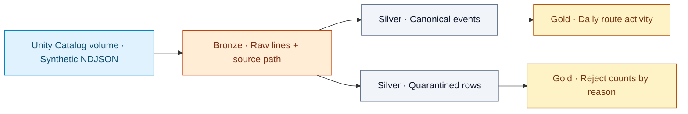

# Cargo Medallion

Cargo Medallion is a Databricks lakehouse demo for shipment milestone events. It ingests synthetic cargo scans with Auto Loader, quarantines invalid and conflicting records, and publishes Delta-backed views for daily route activity and data quality. A Lakeflow Job seeds the input, refreshes the pipeline, and checks the published results.

[Architecture and operating notes](docs/architecture.md) · [Pipeline source](src/pipeline.py) · [Deployment bundle](databricks.yml)



## What the demo proves

| Check | Expected result |
| --- | --- |
| Bronze ingestion | 13 raw rows with source paths across two immutable input files |
| Silver event validation | 5 accepted events, including one late-arriving event |
| Deduplication | Two differently formatted copies of `E02` become one event |
| Conflicting event ID | Both versions of `E05` are quarantined and excluded from route metrics |
| Quarantine | 7 source rows across 6 rejection reasons |
| UTC reporting | Four route-day rows. The `HYD → SIN` delivery with a `−05:00` offset lands on May 4 UTC |

## Run the Spark test locally

From the repository root, use Python 3.10–3.12 and JDK 17 or 21. The test runs the pipeline's PySpark transformations against both batches and checks that a later conflict removes the earlier event from Silver. Databricks handles Auto Loader, managed storage and orchestration in the workspace.

```bash
cd cargo-medallion
python -m venv .venv
source .venv/bin/activate
python -m pip install -r requirements-dev.txt
python -m unittest discover -s tests -v
```

## Deploy and run on Databricks

Use a Unity Catalog-enabled workspace with serverless Jobs and Spark Declarative Pipelines. Install Databricks CLI 0.253.0 or later. Use an existing catalog and an empty, dedicated demo schema with managed storage available. The job and pipeline run as the deploying identity by default. It needs permission to create the job and pipeline, plus `USE CATALOG`, `USE SCHEMA`, `CREATE VOLUME`, `CREATE TABLE` and `CREATE MATERIALIZED VIEW` on the relevant Unity Catalog objects. If you provide an existing volume, grant the identity `READ VOLUME` and `WRITE VOLUME` there. Use lowercase letters, digits and underscores for names, starting with a letter.

Open a new shell and run from the project directory. Replace the workspace URL and select your demo catalog and schema.

```bash
cd cargo-medallion
databricks auth login --host https://YOUR_WORKSPACE_URL --profile cargo-demo
export BUNDLE_VAR_catalog=main
export BUNDLE_VAR_schema=cargo_medallion_demo
databricks bundle validate -t demo --profile cargo-demo
databricks bundle deploy -t demo --profile cargo-demo
databricks bundle run -t demo --profile cargo-demo cargo_demo
```

The workspace run should show `seed → refresh → verify`, with the final step reporting `Cargo Medallion smoke checks passed`. Trigger the same job again to exercise the seed and pipeline checkpoints. Both runs should report the same counts. The verification task expects an unchanged fixture dataset. Keep additional inputs in a separate schema and pipeline.

Query from a SQL warehouse, substituting your configured catalog and schema.

```sql
SELECT event_date_utc, origin, destination, events, distinct_shipments,
       departed_events, delivered_events
FROM main.cargo_medallion_demo.gold_cargo_route_daily
ORDER BY event_date_utc, origin, destination;

SELECT reject_reason, rejected_rows
FROM main.cargo_medallion_demo.gold_cargo_quality
ORDER BY rejected_rows DESC, reject_reason;
```

## Project files

| Path | Contents |
| --- | --- |
| `resources/cargo.yml` | Serverless pipeline and three-task Lakeflow Job |
| `src/pipeline.py` | Bronze, Silver and Gold definitions |
| `src/seed.py`, `src/verify.py` | Idempotent fixture upload and workspace smoke checks |
| `fixtures/` | Two synthetic NDJSON batches |
| `tests/test_pipeline.py` | Local Spark integration test |
| `docs/architecture.md` | Data contracts, replay behavior and operational trade-offs |

This project uses synthetic data exclusively. All shipment identifiers and event histories are invented.
