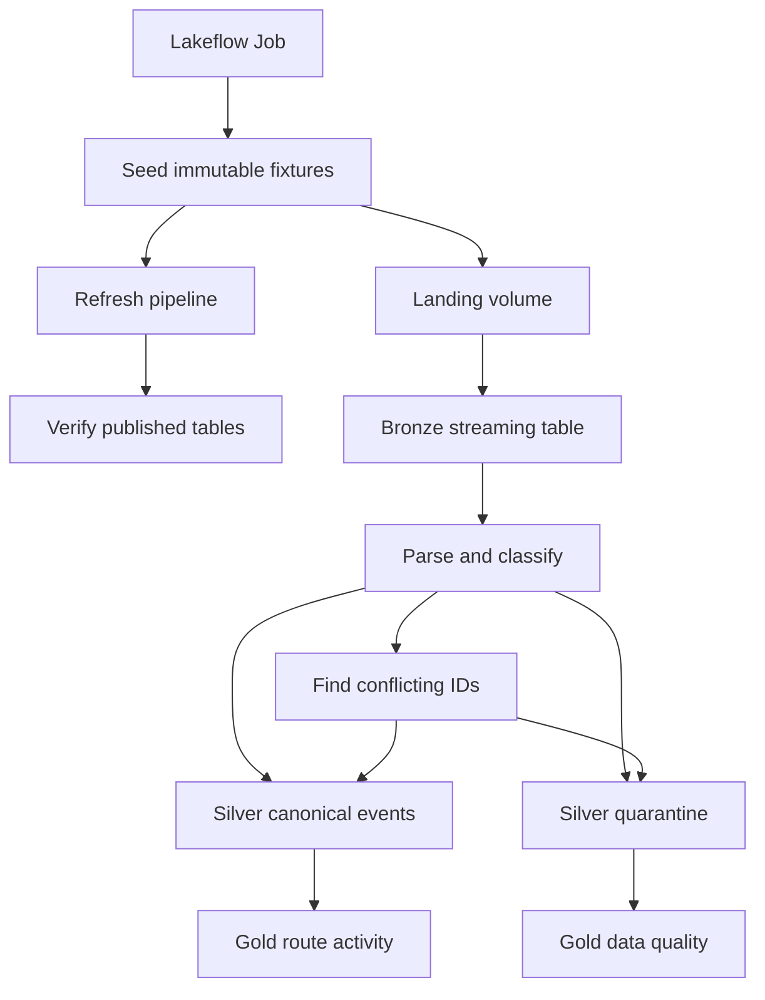

# Cargo Medallion architecture

The ingest path handles append-only event files. A route can gain activity from delayed files and lose activity when a later delivery reveals a conflicting event ID. A triggered Lakeflow pipeline refreshes the current view of those facts after each job run.

## Data contracts

| Dataset | Grain | Contract |
| --- | --- | --- |
| `bronze_cargo_raw` | One row per ingested line | Retain the original text and source file path, including malformed JSON and repeated business events. |
| `silver_cargo_events` | One row per accepted event ID | Trim identifiers, normalize airport codes and event type, and parse explicit ISO 8601 offsets. Require event and shipment IDs, a timestamp, distinct three-letter airport codes, and a supported event type. |
| `silver_cargo_quarantine` | One rejected or conflicting source row | Preserve raw text and source path. Syntax and field validation report the first failure in evaluation order. Each otherwise valid row with a conflicting ID receives `CONFLICTING_EVENT_ID`. |
| `gold_cargo_route_daily` | One UTC date and directional airport pair | Count accepted events, distinct shipments, departures and deliveries. Distinct shipments are specific to each route-day and should be recomputed for a wider reporting period. |
| `gold_cargo_quality` | One rejection reason | Count rejected source rows across the ingested dataset. |

The six tracked fields are `event_id`, `shipment_id`, `event_ts`, `origin`, `destination` and `event_type`. Event types are `BOOKED`, `DEPARTED`, `ARRIVED` and `DELIVERED`. Additional fields stay available in Bronze for future contract changes. Airport validation checks structure only.

## Replay, late data and conflicts

- **File replay.** The seed task checks existing files against the bundled fixtures and never overwrites them. Auto Loader tracks file progress in the pipeline-managed checkpoint. A second file with an already-seen event still enters Bronze and is handled at the business-key level in Silver.
- **Event deduplication.** An event ID denotes one immutable milestone. Copies with the same normalized business fields collapse to one Silver row even if their raw text differs. Valid copies that disagree on any business field put the entire ID into quarantine. Resolving a disputed ID requires a separate correction policy.
- **Late files.** The demo applies no event-time cutoff. Gold can backfill older UTC route-days, and newly disputed IDs can retract prior contributions. Materialized views express those corrections from the retained Bronze history. Refresh plans and costs depend on the query and its data.
- **Recovery.** Repair and rerun a failed job after inspecting the failed task. Normal runs keep pipeline state. A full refresh rebuilds from the input files still available and should be used only when that retained input can reproduce the intended history.
- **Audit.** Review Lakeflow Jobs task output, the pipeline graph and event log, and quarantine grouped by reason and source file. Give reporting consumers access to Gold and restrict raw payloads and quarantine to operators.

## Deployment boundaries

The demo uses one dedicated Unity Catalog schema and layer-prefixed objects so a single deployment is easy to repeat. The landing volume, job, pipeline, and tables should be isolated per deployment. Use one deploying identity per schema. The job limits runs to one at a time and has no active schedule.

For a larger installation, use separate schemas if layer-specific access needs stronger boundaries. Agree on file retention and correction semantics before setting replay requirements. Benchmark the full-history conflict detection and materialized view refresh as event volume grows. A bounded deduplication window or an indexed event-ID registry changes the treatment of old duplicates and requires an explicit policy.

## Databricks references

- [Declarative Automation Bundle resource definitions](https://docs.databricks.com/aws/en/dev-tools/bundles/resources)
- [Spark Declarative Pipelines](https://docs.databricks.com/aws/en/ldp/concepts/pipelines)
- [Auto Loader checkpoint and schema behavior](https://docs.databricks.com/aws/en/ingestion/cloud-object-storage/auto-loader/schema)
- [File metadata columns](https://docs.databricks.com/aws/en/ingestion/file-metadata-column)
